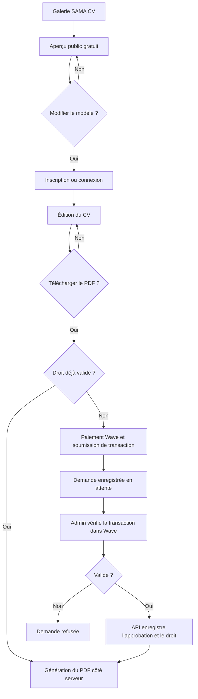

# ARCHITECTURE.md — SAMA CV

## Vue d’ensemble

SAMA CV est une galerie HTML éditable qui contient quatorze modèles intégrés et peut découvrir d’autres modèles ajoutés à la racine du dépôt. La cible commerciale ajoute des comptes, des droits d’accès, le paiement Wave et un déploiement Vercel/Supabase.

Le navigateur sert à éditer et prévisualiser les CV. Il n’est pas une frontière de sécurité : un modèle livré comme fichier statique peut être récupéré directement. Les contrôles d’accès et l’octroi des achats doivent donc être décidés et appliqués par le backend.

## Flux utilisateur

L’ID saisi par le client n’est jamais une preuve. Le navigateur ne peut ni confirmer une transaction ni accorder un droit : un administrateur authentifié vérifie le paiement dans Wave avant de l’approuver côté serveur. L’automatisation par webhook reste suspendue jusqu’à réception de la documentation officielle Wave.

## Composants

- `index.html` : galerie et points d’entrée connexion/inscription.
- `login.html`, `signup.html` : formulaires natifs utilisant Supabase Auth.
- `assets/auth.js` : gestion de session, chargement des variables publiques et soumission d’une demande de paiement ; aucun secret serveur.
- `api/config.js` : expose uniquement les variables publiques Supabase et le lien Wave validé.
- `payment.html` et `api/payments.js` : paiement par lien Wave configuré puis création d’une demande `pending`, sans autorité client sur l’achat.
- `api/admin/payments.js` : vérifie l’identité et le rôle admin auprès de Supabase, puis permet la validation ou le refus manuel.
- `api/entitlements.js` : vérifie les droits côté serveur.
- `api/download-pdf.js` : vérifie la session et le droit, nettoie le contenu du CV édité et génère le PDF avec Chromium à partir du modèle HTML de confiance.
- `api/models.js` : découvre les fichiers `modelN.html` de la racine et expose le catalogue utilisé par la galerie et l’administration.
- `api/protected-model.js` et `vercel.json` : réécrivent toutes les URLs `modelN.html` (N de 1 à 9999) vers une fonction qui sert le modèle pour l’aperçu public. `assets/protection.js` rend l’édition disponible après connexion ; cette interface côté navigateur n’est pas une frontière de sécurité.
- `api/session.js` : synchronise la session Supabase vers un cookie `HttpOnly`, `Secure`, `SameSite=Lax` afin que les navigations HTML transmettent l’identité au serveur.
- `admin.html` : interface de revue manuelle ; l’autorisation est aussi vérifiée côté API.
- `supabase/migrations/001_manual_wave_payments.sql` et `002_dynamic_model_ids.sql` : paiements en attente, droits par modèle, RLS, fonction transactionnelle de validation et validation des numéros de modèles extensibles.

## Données et autorisations

La migration de départ définit `payments` et `entitlements`. Chaque droit relie un utilisateur à un modèle acheté. Les politiques RLS permettent à un utilisateur de lire ses propres données et interdisent au client de s’attribuer un rôle admin, de confirmer son paiement ou de créer un droit sans validation serveur.

Le rôle admin est attribué hors du parcours d’inscription, par une procédure contrôlée. Une adresse email seule ou une variable JavaScript ne suffit pas à établir ce rôle.

### État du projet Supabase communiqué

Les notes du propriétaire du 8 octobre 2026 indiquent qu’un projet Supabase nommé `rdsg-fitness` aurait été créé en Europe de l’Ouest, avec PostgreSQL et l’extension `pgcrypto`. Le nom est à confirmer et l’URL réelle du projet n’a pas été communiquée ; `https://[ton-projet].supabase.co` est un exemple, pas une URL exploitable. Ces éléments ne prouvent pas que le projet est relié à ce dépôt ni que ses paramètres ont été testés.

Les mêmes notes signalent une table `public.users` comportant `id`, `email`, `password_hash`, `created_at`, `last_login`, `is_admin` et `is_banned`. Cette table n’est pas définie par la migration suivie dans ce dépôt et l’application s’authentifie auprès de Supabase Auth (`auth.users`). Supabase Auth doit rester la source de vérité pour les identités et mots de passe : ne pas recopier les mots de passe ou leurs hachages dans `public.users`, ni utiliser ses colonnes de rôle comme autorité sans migration et contrôles serveur explicites. La correspondance et l’usage éventuel de cette table doivent être vérifiés dans le tableau de bord avant toute intégration.

La migration `supabase/migrations/001_manual_wave_payments.sql` crée les tables `payments` et `entitlements` liées à `auth.users`. La migration `002_dynamic_model_ids.sql` élargit les contraintes afin d’accepter les modèles numérotés de 1 à 9999 ; exécuter les migrations dans l’ordre. Elles ne créent pas `public.users` et l’activation de `pgcrypto` n’est pas une preuve que ces migrations applicatives ont été exécutées.

## Paiement Wave manuel

Le lien de paiement est public et le client soumet ensuite un identifiant de transaction. L’API enregistre le montant fixe de 2 000 XOF et l’état `pending` ; elle ne valide jamais automatiquement cet identifiant. Un admin vérifie la transaction dans le tableau de bord Wave Business, puis approuve ou refuse la demande. La fonction SQL verrouille la demande et enregistre le droit de façon atomique.

Le compte Wave et le lien seul ne permettent pas d’implémenter un checkout ou un webhook automatisé. Ne pas inventer les endpoints ou méthodes de signature Wave. Une clé serveur Supabase (`SUPABASE_SERVICE_ROLE_KEY`, `SUPABASE_SECRET_KEY` ou `SUPABASE_SERVICE_KEY`) est nécessaire pour les fonctions de soumission, de droits et d’administration ; elle ne doit jamais être exposée au navigateur.

## Distribution des modèles et PDF

Les requêtes vers `modelN.html` (N de 1 à 9999) sont réécrites vers `api/protected-model.js`, qui sert le modèle pour l’aperçu public. Les fichiers de modèles sont inclus dans le bundling Vercel par motif ; l’ajout d’un nouveau fichier n’exige pas de nouvelle route. `lib/model-template.js` ajoute les scripts partagés et les dimensions de portrait ; `protection.js` ajoute les commandes d’édition et de téléchargement aux modèles qui ont `#cvContainer`, ainsi qu’un filigrane visuel répété avant validation du droit. Le filigrane côté navigateur est dissuasif et ne protège pas le contenu HTML déjà livré contre l’inspection ou les captures d’écran. La véritable barrière de paiement est `api/download-pdf.js`, qui vérifie le droit côté serveur avant de générer le PDF sans filigrane.

`api/download-pdf.js` reçoit le HTML du conteneur édité, le nettoie et l’insère dans le modèle source de confiance avant son rendu par Chromium. L’API vérifie le droit côté serveur puis retourne le PDF avec `Cache-Control: private, no-store`. Les données du CV restent dans le navigateur ; la génération nécessite donc que le client transmette un CV édité valide.

Le PDF est produit à la demande et n’est pas conservé dans un stockage privé. L’impression `window.print()` côté client reste disponible aux administrateurs et ne constitue pas une livraison après achat.

## Variables d’environnement attendues

Les noms définitifs dépendront des SDK/API retenus. Les secrets doivent être enregistrés dans Vercel et dans les environnements locaux ignorés par Git, jamais dans les fichiers HTML ou les migrations.

- `NEXT_PUBLIC_SUPABASE_URL` et `NEXT_PUBLIC_SUPABASE_ANON_KEY` (ou `NEXT_PUBLIC_SUPABASE_PUBLISHABLE_KEY`) côté configuration publique Vercel.
- `NEXT_PUBLIC_WAVE_PAYMENT_LINK` pour le lien `https://pay.wave.com/...`.
- `SUPABASE_SERVICE_ROLE_KEY`, `SUPABASE_SECRET_KEY` ou `SUPABASE_SERVICE_KEY` côté fonctions serveur uniquement.
- Identifiants/API key Wave Business côté serveur uniquement.
- Secret de signature webhook si Wave en fournit un.
- URL publique de l’application et URL webhook configurée chez Wave.

Le dépôt contient `package.json` pour le rendu PDF côté serveur et `vercel.json` pour les fonctions et les réécritures de modèles. Aucun nom de projet ou URL Supabase réelle ne doit être déduit des exemples.

## Déploiement

1. Configurer le projet Supabase, les migrations, RLS et le compte admin.
2. Renseigner les variables d’environnement Vercel Preview et Production séparément.
3. Déployer d’abord en Preview avec le sandbox Wave et tester les scénarios de paiement.
4. Vérifier les logs sans données sensibles, les retours webhook et les droits accordés.
5. Passer en Production uniquement après validation explicite des comptes marchand et des tests.